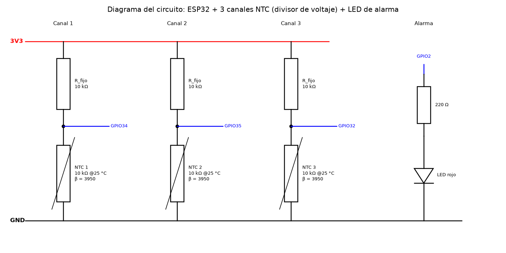

# Memoria de cálculo R1 — Circuito de acondicionamiento

> Generado por `0_diseno/diseno_circuito.py`. Valores calculados con los datos nominales.

## 1. Diagrama del circuito

Cada canal es un divisor de voltaje: `3V3 ── R_fijo ── nodo ── NTC ── GND`, y el nodo
va a un pin del ADC del ESP32 (GPIO34, GPIO35, GPIO32). El LED de alarma va en GPIO2
con un resistor de 220 Ω.

## 2. Datos

| Dato | Valor |
|---|---|
| NTC | R0 = 10 kΩ a 25 °C, β = 3950 K |
| Alimentación | Vcc = 3,3 V |
| ADC | 12 bits (0–4095 cuentas) |
| Rango de operación | 0 a 40 °C |

Ecuaciones:

- NTC: R(T) = R0 · e^(β·(1/T − 1/298,15)), con T en kelvin.
- Divisor: V = Vcc · R(T) / (R_fijo + R(T)).
- ADC: cuenta = V / Vcc · 4095.

## 3. Cálculo del resistor fijo

**Criterio:** elegir el R_fijo que dé la mayor variación de voltaje entre 0 y 40 °C,
ΔV = V(0 °C) − V(40 °C). Más variación significa más cuentas del ADC para el mismo
rango, es decir, mejor resolución.

**Paso 1.** Resistencia del NTC en los extremos del rango:
R(0 °C) = 33621 Ω y R(40 °C) = 5301 Ω.

**Paso 2.** Al derivar ΔV respecto a R_fijo e igualar a cero se obtiene:

R_fijo* = √(R(0 °C) · R(40 °C)) = √(33621 · 5301) = **13351 Ω**

**Paso 3.** Comparación de valores comerciales (ΔV óptimo = 1.424 V):

| R_fijo | V(0 °C) [V] | V(40 °C) [V] | ΔV [V] | % del óptimo |
|---|---|---|---|---|
| 8.2 kΩ | 2.653 | 1.296 | 1.357 | 95.3 % |
| 10 kΩ | 2.543 | 1.143 | 1.400 | 98.3 % |
| 12 kΩ | 2.432 | 1.011 | 1.421 | 99.8 % |
| 15 kΩ | 2.282 | 0.862 | 1.420 | 99.7 % |
| 18 kΩ | 2.149 | 0.751 | 1.398 | 98.2 % |

**Decisión: R_fijo = 10 kΩ.** El mejor valor comercial sería 12 kΩ, pero el
módulo NTC de Wokwi trae 10 kΩ fijo. Con 10 kΩ se obtiene el 98.3 % de la
variación óptima, una pérdida despreciable.

## 4. Resolución en °C por cuenta del ADC (R_fijo = 10 kΩ)

Resolución = 1 / |dADC/dT|, con

dADC/dT = 4095 · R_fijo · (dR/dT) / (R_fijo + R)²  y  dR/dT = −β · R / T²  (T en kelvin).

| T [°C] | R_NTC [Ω] | V nodo [V] | ADC [cuentas] | Resolución [°C/cuenta] |
|---|---|---|---|---|
| 0 | 33621 | 2.543 | 3156 | **0.0261** |
| 5 | 25925 | 2.381 | 2955 | **0.0238** |
| 20 | 12535 | 1.836 | 2278 | **0.0215** |
| 40 | 5301 | 1.143 | 1419 | **0.0268** |

En todo el rango, una cuenta del ADC equivale a unos 0,02–0,03 °C, mucho menos que la
exactitud pedida en R7 (0,4 °C). La resolución no limita la medición.

Sí, la implementación coincide con `0_diseno`. Los valores son los mismos y la fórmula del firmware corresponde exactamente al circuito diseñado.

## Comparación

| Elemento | `0_diseno` | Firmware / `diagram.json` |
|---|---|---|
| Circuito | 3V3 → R_fijo → nodo → NTC → GND | `R = R_FIJO·adc/(4095 − adc)`, que es la fórmula para el NTC conectado a GND ✔ |
| Resistor fijo | 10 kΩ | `R_FIJO = 10000` (el módulo de Wokwi trae 10 kΩ) ✔ |
| NTC | 10 kΩ a 25 °C, β = 3950 | `R0 = 10000`, `BETA = 3950`, `"beta": "3950"` ✔ |
| ADC | 12 bits (0–4095) | `analogReadResolution(12)`, `ADC_MAX = 4095` ✔ |
| Pines | GPIO34, 35, 32 y LED en GPIO2 con 220 Ω | Iguales ✔ |
| Rango | 0–40 °C | Fuera de 0–40 °C la lectura se marca `NA` y activa la alarma ✔ |

Hay dos detalles que no son errores, pero conviene que los tengas presentes:
- **El firmware todavía usa la fórmula β nominal, no los coeficientes calibrados de E1.** Eso queda para R19. En Wokwi no afecta, porque allí los sensores son ideales y coinciden con los valores nominales.
- **Al arrancar, el LED se enciende.** Pasa porque `diagram.json` pone el sensor 2 a 12 °C. Es lo esperado y sirve para ver la alarma de inmediato.

## Cómo probar la electrónica en Wokwi

Compila y arranca la simulación como dice `1_electronica/README.md`. Después haz estas pruebas mirando el monitor serie:

**1. Conversión (verifica el diseño de R1).** Haz clic en el sensor 1, mueve el deslizador a cada temperatura y compara `adc_1` y `T_1` con estos valores. Los calculé con las mismas ecuaciones de `0_diseno`:

| Temperatura del deslizador | `adc_1` esperado | `T_1` esperado |
|---|---|---|
| 0 °C | ≈ 3156 | 0,0 |
| 5 °C | ≈ 2955 | 5,0 |
| 20 °C | ≈ 2278 | 20,0 |
| 40 °C | ≈ 1419 | 40,0 |

Se acepta una diferencia de pocas cuentas y de unos ±0,05 °C. Si las cuentas cambian en la dirección contraria (más cuentas con más temperatura), la conexión del divisor está invertida.

**2. Alarma y LED.** Pon los tres sensores en 5 °C: debe salir `alarma = 0` y el LED debe apagarse. Luego mueve solo uno:

| Valor | Resultado esperado |
|---|---|
| 8,1 °C | `alarma = 1`, LED encendido |
| 1,9 °C | `alarma = 1`, LED encendido |
| 2,0 °C y 8,0 °C | Son los límites: el firmware usa `<` y `>`, así que en el borde no hay alarma, aunque el redondeo a centésimas puede hacer que salte |

