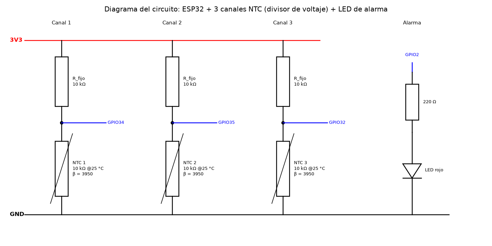

# 1_electronica — Firmware, adquisición y montaje (R2, R3)

Todo el montaje es **SIMULADO** en Wokwi.

## Contenido

| Archivo / carpeta | Para qué sirve |
|---|---|
| `firmware_esp32/` | Proyecto PlatformIO + Wokwi (`src/main.cpp`, `diagram.json`, `wokwi.toml`) |
| `justificacion_ts.py` | Justificación numérica de Ts (R2) → `resultados/justificacion_Ts.md` |
| `verificar_perdida.py` | Calcula la pérdida de muestras de una captura serie (R2) → `resultados/perdida_muestras.md` |
| `pruebas_simulacion/` | Capturas del monitor serie |
| `resultados/` | Informes generados |

## R3 — Montaje reproducible

### Lista de materiales

| Cant. | Elemento | Parte en Wokwi | Valor |
|---|---|---|---|
| 1 | ESP32 DevKit C v4 | `board-esp32-devkit-c-v4` | — |
| 3 | Módulo termistor NTC (incluye R_fijo) | `wokwi-ntc-temperature-sensor` | NTC 10 kΩ @25 °C, β = 3950; R_fijo 10 kΩ |
| 1 | Resistor del LED | `wokwi-resistor` | 220 Ω |
| 1 | LED rojo | `wokwi-led` | — |

### Esquemático



(Generado por `0_diseno/diseno_circuito.py`; el cálculo del resistor fijo está en
`0_diseno/resultados/memoria_calculo_R1.md`.)

### Tabla de pines

| Elemento | Pin del elemento | Pin del ESP32 | Función |
|---|---|---|---|
| Sensor 1 (`ntc1`) | VCC / GND / OUT | 3V3 / GND / **GPIO34** (ADC1_CH6) | Canal 1 |
| Sensor 2 (`ntc2`) | VCC / GND / OUT | 3V3 / GND / **GPIO35** (ADC1_CH7) | Canal 2 |
| Sensor 3 (`ntc3`) | VCC / GND / OUT | 3V3 / GND / **GPIO32** (ADC1_CH4) | Canal 3 |
| Resistor 220 Ω (`r1`) | 1 / 2 | **GPIO2** / ánodo del LED | Limita la corriente del LED (~6,8 mA) |
| LED rojo (`led1`) | ánodo / cátodo | resistor / GND | Alarma |

### Pasos para reproducir el montaje desde cero en wokwi.com

1. Cree un proyecto **ESP32 (Arduino)**.
2. Agregue (botón **+**) tres "NTC Temperature Sensor", un resistor y un LED rojo.
3. Ponga el resistor en 220 Ω y cablee según la tabla de pines.
4. Copie `firmware_esp32/src/main.cpp` en `sketch.ino`.
5. Pulse ▶. El monitor serie debe mostrar el encabezado
   `t_ms,adc_1,adc_2,adc_3,T_1,T_2,T_3,alarma,Origen` y una fila por segundo.

Atajo: pegar `firmware_esp32/diagram.json` en la pestaña `diagram.json` crea el
circuito completo de una vez.

### Fotografía del montaje

Como el montaje es simulado, la "fotografía" es una captura de pantalla de Wokwi
con la simulación corriendo. Guárdela como `1_electronica/montaje_wokwi.png`.
**PENDIENTE: la captura debe tomarla el equipo.**

## R2 — Firmware de adquisición

- **Lectura:** los 3 canales se leen seguidos y se emite una fila CSV por ciclo
  con marca de tiempo `t_ms` (ver el diccionario de datos en el README principal).
- **Periodo de muestreo:** `TS_MS = 1000` en `main.cpp`. El muestreo es de periodo
  fijo (el siguiente instante se calcula sumando Ts al anterior), así el tiempo de
  procesamiento no acumula retraso.
- **Justificación de Ts:** `python 1_electronica/justificacion_ts.py`. Usa las
  dinámicas de los datos de E3 y los retardos máximos de R13. Resultado:
  intervalo admisible ≈ 10 ms ≤ Ts ≤ 3 s; se elige 1 s.

### Captura de 10 minutos y pérdida de muestras

**Opción A, manual (VS Code o wokwi.com):**
1. Compile y arranque la simulación (ver la sección "Firmware en Wokwi" del README principal).
2. Deje correr al menos **10 min y 10 s** de tiempo simulado.
   Mueva el deslizador de algún NTC durante la corrida para que se vean alarmas.
3. Copie todo el texto del monitor serie en
   `1_electronica/pruebas_simulacion/captura_10min.csv`.
4. Ejecute `python 1_electronica/verificar_perdida.py`.

**Opción B, automática con Wokwi CLI** (requiere el token `WOKWI_CLI_TOKEN` de
<https://wokwi.com/dashboard/ci>):

```bash
cd 1_electronica/firmware_esp32
pio run
wokwi-cli --timeout 610000 --timeout-exit-code 0 --serial-log-file ../pruebas_simulacion/captura_10min.csv .
cd ../..
python 1_electronica/verificar_perdida.py
```

Criterio de aceptación: pérdida ≤ 0,5 % en un registro ≥ 10 min.
**PENDIENTE: falta grabar la captura** (no hay corrida de 10 min en el formato actual).
